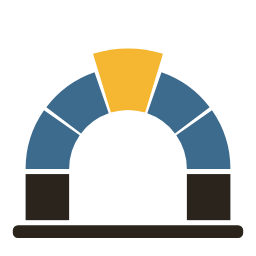
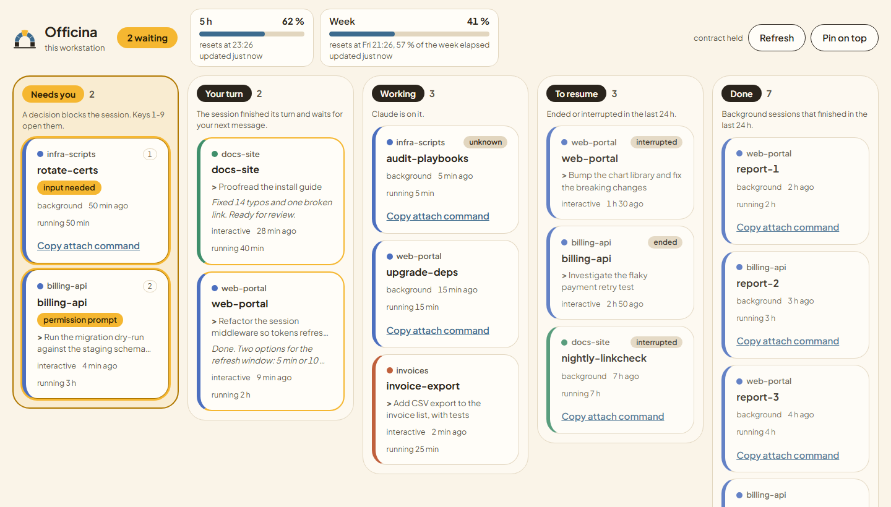
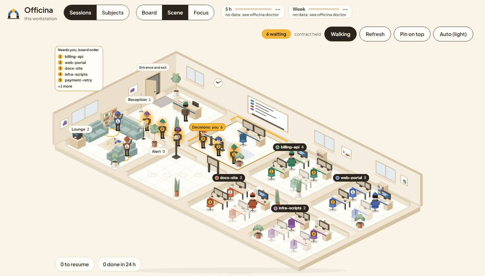
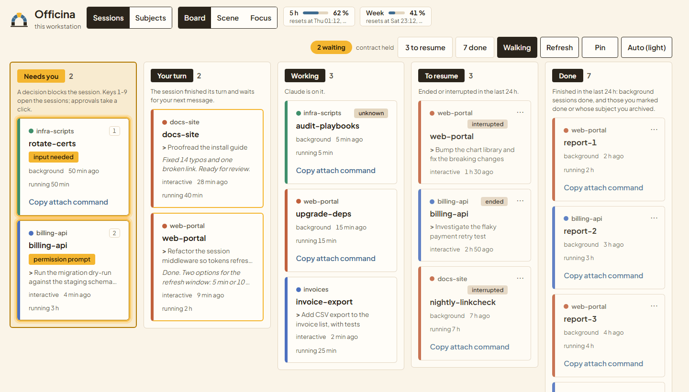
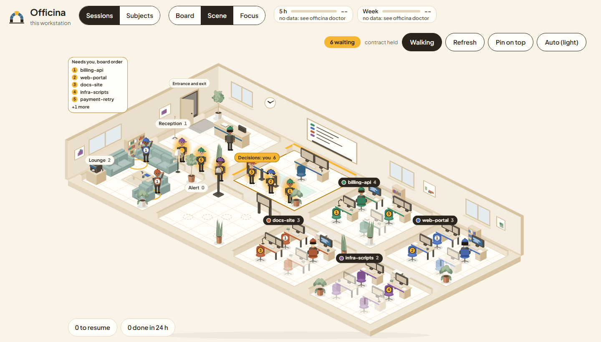

<p align="center">
  <picture>
    <source media="(prefers-color-scheme: dark)" srcset="docs/assets/logo-dark.png">
    
  </picture>
  <h1 align="center">Officina</h1>
  <p align="center"><strong>One window that tells you which Claude Code session needs you</strong></p>
</p>

<p align="center">
  <a href="LICENSE"></a>
  
  
  
</p>

---

You run five to ten Claude Code sessions at once, in editor terminals, across several repositories, and you no longer know which terminal is doing what. Officina is a small desktop board that answers three questions at a glance, without touching any session:

- **Who needs me?** A session waiting on a permission prompt or a question.
- **Whose turn is it?** A session that finished its turn and waits for your next message.
- **What is working, what is finished, what was interrupted?**

One click brings the right session to the front. The 5-hour and weekly quotas sit in the header, with their reset times and how fresh the numbers are.

<p align="center">
  
</p>

<p align="center">
  
</p>

<p align="center">
  
</p>

*The sessions shown are fictitious.*

## Why another tool

The scarce resource is your attention, not your quota. Each subject needs a cycle of focus, study, decision and validation, and that cycle does not hold across six subjects at once. Officina's first job is to stop you from cycling through terminal tabs to find the one that is blocked.

## How it reads your sessions

Officina hosts nothing and owns no session process. It only reads documented Claude Code surfaces:

| Source | What it gives |
|---|---|
| `claude agents --json --all` | every live session, its status (`busy`, `waiting`, `idle`), what it waits for, background session state |
| Hook events (`officina hook`) | last prompt, last answer, permission notifications, how a session ended |
| Your statusline (`officina quota write`) | the 5-hour and weekly rate limits of your account |

Missing data is shown as **unknown**, never as finished. Officina never writes to your Claude Code configuration: `officina doctor` prints what to paste, you paste it.

Claude Code updates itself, so Officina checks, for each version it runs under, that what it reads is still there: the `claude agents` fields, against each session list, and the hook payload fields it reads, listed per event in `HOOK_FIELDS` (`crates/officina-core/src/contract.rs`). The hook notes on each event line the fields of that list its payload lacked; the window records them under the running version, counting only lines from the time it first saw that version, so an upgrade does not inherit the gaps of the one before. A missing field shows in the header's contract chip and in `officina doctor`, which also lists the events no line of this version has carried yet.

### The columns

| Column | Meaning |
|---|---|
| **Needs you** | A decision blocks the session: a permission prompt, a question, a dialog. Amber, numbered 1 to 9 for the keyboard. A new wait's amber ring breathes for two minutes, then stays steady; with reduced motion turned on in Windows, it is steady from the start. |
| **Your turn** | An interactive session finished its turn and waits for your next message. Even when it asked you something in plain text, Claude Code reports it as idle, so it lands here, never in Done. |
| **Working** | Claude is on it. A session whose state Officina cannot tell shows here with an `unknown` badge. |
| **To resume** | Ended, stopped or interrupted in the last 24 hours. |
| **Done** | Finished in the last 24 hours: background sessions Claude Code reports done, and sessions you marked done or whose subject you archived, each tagged so. Collapsed beyond five. |

### Moving an ended card

An ended card can be dragged onto **Done** (you mark it done), back onto **To resume**, or onto the **Discard** target that shows at the bottom of the window while you drag, for a session that was never real work, a ten-second test for instance. Escape cancels a drag. The card's menu, at its top right, does the same from the keyboard: Enter or Down opens it, the arrows move, Enter chooses, Escape closes it. A note then says what was done, with **Undo**; after a menu choice the focus goes to it, and back to the card after an undo. Your verdict is recorded in the registry, never inferred: it covers what the session did before it, so a session that comes back to life is placed by its own state again. A discarded session leaves the board and the scene; **Show archived subjects and discarded sessions** in the Subjects view lists it with **Restore**. A card in Done because its subject was archived goes back to To resume by reopening that subject, which you archive again from the Subjects view. Live cards do not move: their column is what Claude Code reports.

### Bringing a session to the front

- **Interactive session** in an editor or terminal: Officina walks up from the session's process to the window that hosts it. VS Code runs every window from one process, so Officina picks the window whose title contains the session's folder name, then each parent folder. When several windows match, it lists them instead of guessing. It brings the window forward; choosing the terminal tab inside the editor stays with you.
- **Background session**: Officina opens `claude attach <id>` in a new console, from the `claude` binary's folder. The card can also copy that command for you. When `claude` resolves to anything but the native `claude.exe` (a `.cmd` or `.bat` shim, say), Officina does not run it, and the attach fails with a message pointing at that copy: paste it into your own terminal.

If the wrong window comes up, click **Wrong window?**: Officina counts how often its first click is right.

## Install

Officina v0.1 targets Windows 10 and 11 (x64). Linux builds arrive with v1.

1. Download `officina-<version>-windows-x64-portable.zip` or the installer from the [releases](https://github.com/Rwx-G/Officina/releases). The binaries are not signed yet, so SmartScreen will warn on first launch.
2. Put `officina.exe` somewhere on your `PATH`.
3. Run `officina doctor` and follow what it prints.

Officina finds `claude` through `OFFICINA_CLAUDE_BIN`, then the absolute folders of `PATH` (`claude.exe`, then `claude.cmd`), then `~/.local/bin`, where the native installer puts it. It runs the native `claude.exe` only: a `.cmd` or `.bat` shim (an npm install), or any file that is not an `.exe`, is refused for every call, since `cmd.exe` would run whatever the script says, so the board then lists no live session, attach falls back to copying its command, and doctor fails with one line naming every refused use. Install the native `claude.exe`, or set `OFFICINA_CLAUDE_BIN` to it.

### Wiring the hooks

The hooks go in your **user** settings (`~/.claude/settings.json`), so every project gets them without touching any repository. `officina doctor` prints that file's whole `"hooks"` key with Officina's registrations merged in: every hook already there stays as it is, Officina's are added once, and a gate entry merged earlier without every tool or without `onFailure` is replaced rather than doubled. Replace the file's `"hooks"` key with it; when the file does not exist, doctor prints its whole content instead. It never prints another key of the file, since those can hold environment values or tokens, and for a file it cannot read as JSON it prints the reason and no block. Doctor also writes each block it prints to a file under the Officina home, named on its line (`~/.officina/doctor/user-hooks.json` for this one), since a terminal can cut a long line, the `command` with your `officina.exe` path included, when you copy it: copy from the file. Each run replaces those files, and they are Officina's own. Run doctor again afterwards: it then reports the hooks registered and prints nothing for them. Without other hooks, the block looks like this, with the absolute path of your `officina.exe`:

```json
{
  "hooks": {
    "SessionStart":     [{ "hooks": [{ "type": "command", "command": "\"C:/path/to/officina.exe\" hook", "timeout": 5 }] }],
    "SessionEnd":       [{ "hooks": [{ "type": "command", "command": "\"C:/path/to/officina.exe\" hook", "timeout": 5 }] }],
    "UserPromptSubmit": [{ "hooks": [{ "type": "command", "command": "\"C:/path/to/officina.exe\" hook", "timeout": 5 }] }],
    "Stop":             [{ "hooks": [{ "type": "command", "command": "\"C:/path/to/officina.exe\" hook", "timeout": 5 }] }],
    "Notification":     [{ "hooks": [{ "type": "command", "command": "\"C:/path/to/officina.exe\" hook", "timeout": 5 }] }],
    "SubagentStart":    [{ "hooks": [{ "type": "command", "command": "\"C:/path/to/officina.exe\" hook", "timeout": 5 }] }],
    "SubagentStop":     [{ "hooks": [{ "type": "command", "command": "\"C:/path/to/officina.exe\" hook", "timeout": 5 }] }]
  }
}
```

The two sub-agent events draw each running sub-agent beside the session that spawned it (see [Sub-agents](#sub-agents)); their lines keep the sub-agent's id and type, never its answer or transcripts. If you pasted the block before they appeared, paste it again: doctor reports them missing until you do, and the scene shows no sub-agent meanwhile.

Hooks from user settings run alongside each project's own hooks. The hook appends one line to a local file and exits: no network, no server, no port. It always exits 0, so a broken Officina can never block a session, except through the relay's gate below. Measured p95: about 20 ms, process start included.

Once the floor guards a repository (see [Relay](#relay-v02-in-progress)), the block gains the gate's entry, which fails closed:

```json
"PreToolUse": [{ "matcher": "<every tool the gate reads>", "hooks": [{ "type": "command", "command": "\"C:/path/to/officina.exe\" hook", "timeout": 5, "onFailure": "block" }] }]
```

Claude Code lets a tool call through when a hook fails, unless the hook entry sets `"onFailure": "block"`, which Claude Code honours from 2.1.295. With it, a gate that cannot start, times out or crashes blocks the call instead. If you merged the gate's entry before Officina printed this field, paste the block doctor prints again.

### Wiring the quota (optional)

The quota comes from the statusline, which receives your rate limits from Claude Code. One statusline per account is enough. Put `officina quota write --tee` in front of your existing statusline command, in a **personal** settings file (`~/.claude/settings.json` or a project's uncommitted `.claude/settings.local.json`), never in a committed one:

```json
{ "statusLine": { "type": "command", "command": "\"C:/path/to/officina.exe\" quota write --tee | python ~/.claude/statusline.py" } }
```

`--tee` passes the payload through unchanged, so your statusline keeps its output. Without a statusline, the gauges say "no data" and the rest of the board works.

While the quota has no fresh data, `officina doctor` prints the whole `"statusLine"` value to put in your user settings: your command behind `officina quota write --tee`, its other fields kept, or left as it is when it already runs `officina quota write`. A project whose own settings set a statusline wins over yours in sessions opened in its folder; doctor names those folders among the sessions the hook saw recently and prints, for each, the value for its `.claude/settings.local.json` (the whole file when it does not exist), never for a committed file. Each of these blocks is also in a file under `~/.officina/doctor/`, named on its line.

### Starting the board

Run `officina-app.exe`. A second launch focuses the existing window. Keep it on a second screen, or press **Pin** to keep it on top. The window cannot be made smaller than 1140 x 820: the size that keeps the header on two lines and the scene's base floor whole. On a wide screen the board shows cards side by side in each column, and the Subjects and Relay views keep to a readable width. The window title shows `Officina (2 waiting)` whenever something waits on you.

| Key | Action |
|---|---|
| `1` to `9` | bring the nth *Needs you* session to the front |
| `Tab`, `Enter` | move between cards, open one |
| `r` | refresh now |

## Privacy

Everything stays on your machine, under `~/.officina`:

- **Hook events**: the first 280 characters of each prompt and answer, and the last 280 of an answer longer than that, plus the event type, session id and folder, in daily files the window deletes once its registry and both daily copies of it hold them, normally on the third or fourth day; with the window closed or its registry unusable they are kept. Set `OFFICINA_NO_EXCERPTS=1` (or `no_excerpts = true` in the floor file) to keep no prompt or answer text at all. The hook finds the floor file at `~/.officina/floor.toml` or through `OFFICINA_FLOOR`; one passed only with `--floor` does not reach it, and `officina doctor --floor <file>` warns when that file sets `no_excerpts` the hook cannot see.
- **Registry** (`registry/`): each session seen, its project and when it was first and last seen, and its latest prompt and the head and tail of its latest answer, each kept 28 days less an hour after the event it came from; each verdict you confirm keeps a copy of the prompt and answer it was decided on, until they were due to expire; the triage model's answer to a row, when you turned the model on, goes with the excerpts it answered; a daily copy lives two days, so no prompt, answer or model text survives 30 days. Each triage call is kept 90 days as counts and cost, without any text. `no_excerpts` keeps none and clears those already stored at the window's next hourly pass. These bounds are applied while the window runs and when it starts; while it is closed nothing expires. See [Privacy in the registry](#privacy-in-the-registry).
- **Triage model (off by default): what leaves your machine.** While the triage model is on, and while a dry run you started runs, Officina starts `claude -p`, which sends to the Anthropic API, under your account, the case of each row it judges: the session's last prompt and the beginning and end of its last answer, each cut to 280 characters, how the session ended and whether the last prompt came after the last answer; never a subject's name, a folder or a session id. Nothing is sent while the model is off and no dry run runs. To make sure nothing is ever sent, keep the model off and run no dry run, or set `no_excerpts`, which keeps no excerpt to send and makes the model impossible to turn on. See [The triage model](#the-triage-model).
- **Quota**: the two rate-limit windows, nothing else.
- **Focus statistics**: outcome codes and a hash of the card, never a window title or a path.
- **Relay journal** (`journal/`, once you use the relay): one line per run start and end, refusal, gate refusal or fault, approval, stop and resume, with the session id, the action, its parameters and argument vector, the first 280 characters of a refused command unless excerpts are off, and never a program's output.
- **Relay requests and dry runs** (`relay/approvals/`, `relay/outputs/`): each `human` action's request with its parameters and command, kept 24 hours, and the output of each check run, at most 256 KiB, kept 7 days so an approval card can show it.

Officina opens no TCP port and does not read transcripts. Its only network connections are the requests of the HTTP actions an approved catalogue declares, each to the URL it declares, when a session runs one with `officina run`; the hook, the board, `officina relay --json` and the window open none. The `claude` processes the window starts are Claude Code's own and connect as it does; of what Officina hands them, only the triage call carries session text: the excerpts above, while the model is on or a dry run runs.

## Floor file (optional)

Without configuration, a session's project is the name of its folder. A floor file names projects, gives them colours, and can point at another Claude config dir:

```toml
# ~/.officina/floor.toml, or pass --floor <path>, or set OFFICINA_FLOOR
schema = 2
name = "work"
# config_dir = "C:/path/to/claude-config"   # optional, absolute

[[project]]
name = "api"
path = "Api"            # relative to this file, or absolute
color = "blue"          # green, blue, terracotta or plum
autonomy = "free"       # "free" or "guarded"; a schema 2 project without it is guarded
priority = "high"       # optional: "normal" (default) or "high" (v0.4)

[alert]                 # optional (v0.4)
after_minutes = 10      # 1 to 1440, default 10
```

`priority` and `[alert] after_minutes` only change what the window shows (v0.4, in progress): a session of a `high` project that waits for you is in alert at once, and any session that waits for you longer than `after_minutes` is in alert. They authorise nothing, so changing them never asks for the relay's approval again. A value the floor does not accept keeps the default, and `officina doctor` names the key and its line.

Sessions outside every declared project go to `other`; none is hidden. A v0.1 floor (`schema = 1`) still loads, with every project `free`; the relay keys below need `schema = 2`.

## Relay (v0.2, in progress)

The relay lets a session run your routine actions itself, repository by repository, instead of asking you to run a command and paste the result: a dry run of a playbook on a lab group, a service status, a known change applied after its check. You declare the actions in the floor file and approve them in the window; sessions call them with `officina run`; a gate in the hook refuses the raw commands they replace; every run is journaled.

### What it is, and what it is not

A session runs as you. It could, in principle, edit Officina's files or call your tools directly. The relay is a guardrail against mistakes and injected instructions, and a record of what was done on your behalf; it is **not a security boundary**. The boundary comes with the isolated workshop (v0.6), where the worker does not hold your identity.

### Free and guarded repositories

Each project of the floor file is `free` or `guarded`:

- **free**: Officina only shows it, as in v0.1. A free project that lists actions can still run them through `officina run`.
- **guarded**, the default for a schema 2 project: the gate refuses a session's direct calls to the programs that reach other machines (remote shells and copies, Ansible, WSL and the Windows distro launchers), and the session runs the actions you approved instead.

Folders outside every declared project are never touched, and a v0.1 floor (`schema = 1`) keeps every project free. The default list of guarded programs lives in the code (`DEFAULT_GUARDED_PROGRAMS`); `officina doctor` prints the list in effect. A floor can replace it with its own `guarded_programs`, a list of program names where a trailing `*` matches a prefix.

### Declaring the catalogue

The floor file declares the actions, and each project the actions it may use:

```toml
schema = 2

[[project]]
name = "infra"
path = "Infra"
autonomy = "guarded"
actions = ["check", "apply"]

[[action]]
name = "check"
description = "Dry run of a playbook on one lab group"
class = "free"                       # "free", "after-check" or "human"
runner = "wsl"                       # "native" (default) or "wsl"
distro = "Ubuntu"                    # wsl only, optional
program = "/home/user01/venv/bin/ansible-playbook"   # absolute for its runner
env = { ANSIBLE_CONFIG = "/home/user01/ansible.cfg" } # literals only
args = ["--check", "--diff", "-i", "inventory/lab", "--limit", "{group}", "playbooks/{playbook}"]
# timeout_s = 540, max_output_kib = 64 when not set

[action.params.playbook]
values = ["site.yml", "monitoring.yml"]

[action.params.group]
pattern = "lab-[a-z0-9-]{1,30}"      # anchored: the whole value must match

[[action]]
name = "apply"
description = "Apply a playbook on one lab group, after its check"
class = "after-check"
check = "check"                      # a free action with the same parameters
runner = "wsl"
distro = "Ubuntu"
program = "/home/user01/venv/bin/ansible-playbook"
env = { ANSIBLE_CONFIG = "/home/user01/ansible.cfg" }
args = ["-i", "inventory/lab", "--limit", "{group}", "playbooks/{playbook}"]

[action.params.playbook]
values = ["site.yml", "monitoring.yml"]

[action.params.group]
pattern = "lab-[a-z0-9-]{1,30}"
```

- An `args` item holds at most one `{placeholder}`, with an optional literal prefix and suffix, and always becomes exactly one argument: no local shell ever reads it. The program may still read a value further: ssh hands the arguments after its destination to the remote host's shell as one command line, and Ansible templates extra vars and module arguments and expands `~` and `$VAR` in paths. Give such parameters a `values` list, or a pattern without whitespace, shell characters or template characters (`{`, `%`). The catalogue reports these values as notices (`NoticeKind`, one line of explanation each) on the banner, in `officina relay --json` and in `officina doctor`, as warnings. A `pattern` on such a parameter that admits one of the characters of `FORWARDED_PROBE_CHARS` (probed with short values built around them, then at every position of values as short and as long as the pattern accepts, so `.{5,}` is caught) drops the action with the issue `forwarded_pattern`, unless the action sets `forwarded_values = "accepted"`: your word that whatever the pattern admits may reach that remote shell or template. A `values` list is always accepted. The probe finds the common broad patterns; it is not a proof, a `values` list is.
- A parameter declares `values` or a `pattern`, never both. Whatever it declares, a value is refused when it starts with `-`, holds a control, bidirectional or invisible formatting character, or has a `.` or `..` path segment; on the `native` runner also when it starts with `/` or `@`.
- An invalid action is skipped and reported with its line; it never invalidates the floor, so the board keeps working.

The three classes: a `free` action runs; an `after-check` action runs only after its `check` succeeded (see below); a `human` action runs once per approval you give in the window, and may name a `check` too, its dry run, which must succeed first and whose output the approval card shows:

```toml
[[action]]
name = "apply-shared"
description = "Apply a playbook to a shared group, after its dry run and your click"
class = "human"
check = "check"                      # optional: its dry run, a free action with the same parameters
runner = "wsl"
program = "/home/user01/venv/bin/ansible-playbook"
args = ["-i", "inventory/lab", "--limit", "{group}", "playbooks/{playbook}"]
```

A dry run is only as harmless as the program makes it. For Ansible, `--check` does not stop a task that sets `check_mode: false`, nor one that delegates (`delegate_to`, `local_action`, `run_once`): a check action is harmless only if no task it reaches does either.

### Approving it in the window

The relay runs only a catalogue you approved in the window. Approval records a hash of the catalogue's meaning (projects, actions, parameters, guarded programs), not of its text: comments, key order, colours or an invalid action do not change it, any change of meaning does. Only `officina-app.exe` contains the code that approves; `officina.exe`, which sessions can call, does not, and CI checks the shipped binary for it.

When the floor's catalogue differs from the approved one (yours or a session's edit), the header shows an amber "catalogue change" chip and the board a banner with the change: each action added (with the program and arguments it would run), removed or changed field by field, the projects and guarded programs that changed, and the actions the floor skips as invalid, with their lines. **Approve this catalogue** approves exactly what the banner shows, and only on a mouse click: no key approves. If the floor changed again in between, nothing is approved and the banner shows the new change. The window approves the relay's floor (`OFFICINA_FLOOR`, else the approved one, else `~/.officina/floor.toml`), whose path the banner names, even when it shows another floor's board.

**Stop relay**, in the header, makes `officina run` refuse every action until you press **Resume relay**; a terracotta "relay stopped" chip and a banner say so meanwhile. Stopping does not touch the gate, which keeps guarding your projects. Each stop and resume is one journal line.

### Setting it up with `officina doctor`

Run `officina doctor` after each floor edit. Once the floor uses the relay, it checks it end to end:

- the relay floor, and whether it differs from the floor doctor itself reads: the window approves the relay's floor, so a window started with another `--floor` shows one floor's board and approves another;
- the catalogue's issues with their lines, the approval state (approved, change pending, nothing approved yet), the projects with their actions, and the guarded programs in effect;
- that each action's program resolves: a `native` program is an existing file; for a WSL action the system's own `wsl.exe` exists and, in the action's distro, `/usr/bin/env`, `/usr/bin/timeout` and the program are executable;
- for each project with an action that binds its files (one naming a check, or a `human` action), whether its files bind: the `git` it found and how many files it binds, or why it cannot (no `git` where Git for Windows records it, a tree past the fingerprint's limits, a file it cannot read), which fails, since those actions then refuse;
- the decisions the window did not make (see the Relay view below), which fail until you acknowledge them;
- warnings: an action whose timeout, plus the longest wait of a `human` action, can outlive the Bash tool's 10-minute cap; an action naming a check its project does not list (it could never run); a project with actions that bind files outside a git work tree (only the parameters bind); unreadable journal lines and gate errors of the last 24 hours.

A missing `PreToolUse` registration while a project is guarded, a gate entry without `"onFailure": "block"`, a Claude Code too old to honour that field, a program that does not resolve, files that cannot be bound, an unacknowledged anomaly and a relay floor that cannot be read are failures (exit 1); everything else warns. The gate runs inside `officina hook` as a `PreToolUse` hook whose matcher names every shell tool of `SHELL_TOOLS` and every file tool of `FILE_TOOLS`, the constants in the relay's core: once the floor guards a project, doctor adds that registration to the block to paste, and names the tools a matcher you merged earlier leaves out. Its `gate failure mode` line reads `claude --version` and says whether that version blocks a call when the gate's hook fails.

For each guarded project, doctor also prints a paragraph to paste into that repository's `CLAUDE.md`, generated from the approved catalogue: use `officina run` for the listed actions, `officina run --list` to see them and their values, the Bash tool's longest timeout for relay calls, read a refusal's reason before retrying, and run commands with the tools the gate reads. With nothing approved it says the catalogue awaits your approval and lists no action. Officina never writes it: paste it again after approving a change.

### The gate

In a guarded repository the gate reads the command of every call to a shell tool it lexes (`SHELL_TOOLS` gives each tool its rule) and refuses one that would start a guarded program, even through quotes, wrappers, `bash -c`, an interpreter one-liner or a command substitution, along with a command name built at run time, a PowerShell encoded command, a redirection of Officina's home, an `officina` call with `PATH`, a `GIT_` variable or another variable of `OFFICINA_ENVIRONMENT_NAMES` reassigned, and any mention of an `OFFICINA_` setting or of Officina's own files. A refusal holds in every permission mode, bypass included: the session sees why, and the actions it may run instead.

Once the floor guards a project, a file tool (`FILE_TOOLS`: the tools that write a file, Write and Edit among them) aimed anywhere under Officina's home is refused from every project, guarded, free or undeclared: the approvals, the stop flag, the decision record, the journal and the home's floor are written by Officina only. Edit Officina's files yourself, outside a session. A tool an MCP server adds that writes files (a filesystem server's `write_file`, say) is not among them: where such a server is configured, it can write under the home.

A shell tool whose language Officina does not read is refused whole in a guarded project instead: that is the PowerShell tool, which Claude Code turns on by default on Windows for claude.ai accounts. Sessions there keep the Bash tool, and the `CLAUDE.md` paragraph doctor prints tells them to use it. Free projects and undeclared folders keep every tool.

A repository counts as guarded when the current floor or the approved catalogue says so, so a session cannot lift containment by editing the floor, and when it is the session's root or the shell's current folder, so `cd ..` does not leave it. Those folders, and a file tool's target, are resolved by an opened handle before the gate compares them, so an 8.3 short name, a junction, a symbolic link or a `subst` drive leading into a guarded project or into Officina's home counts as the folder it leads to. A guarded project's own path is resolved the same way, once per set of paths, so a floor that declares it through an alias guards the real folder too; a free project's path is compared as written. If the approved catalogue or the floor cannot be read, the gate gets stricter, not looser. Each refusal, and each such fault, is one journal line, with the first 280 characters of the command unless excerpts are off.

When the gate itself fails, it refuses rather than let a call through where it guards. A fault inside the gate, on a call in a guarded repository, prints a deny that says so, and the fault goes to the journal. If the gate cannot tell where the call lies, it refuses too. In a free repository or an undeclared folder the call gets no decision, as the gate has nothing to protect there. A failure the hook cannot catch is left to Claude Code, through the entry's `"onFailure": "block"`: a missing binary, a run past the entry's `timeout`, a crash. Claude Code then blocks every call the gate's matcher names, in every repository, until the hook runs again. That is the price of a gate that holds when Officina breaks.

The gate is a text match, so it has limits: a guarded program hidden in a script file, started by another tool, renamed, or aliased by an earlier command escapes it. The architecture lists what it cannot catch ([AD-27](docs/architecture-v0.2.md)), and the gate's vector set (`tests/vectors/gate.json`) keeps each such case marked as a limit, so an improvement shows up as a changed case.

### Running actions

Sessions run the approved actions themselves, from anywhere inside the project's folder:

```bash
officina run --list                                   # this project's actions and what each parameter accepts
officina run check group=lab-web playbook=site.yml
```

`officina run` checks, in this order, that the relay is not stopped, that the window's record vouches for the approved catalogue, that the floor still holds it, that the folder is in an approved project (free or guarded), that the project lists the action, and that every parameter is declared, given once and accepted. It then starts the program as an argument vector, never through a shell, in the project's folder, with the action's `env`; a WSL action goes through the system's own `wsl.exe` with `--exec`. The program's environment is the one Windows builds from the registry for you, as Explorer gives a new program (the machine's variables and yours, `Path` the machine's then yours), with `ComSpec` the system's `cmd.exe` and `PATHEXT` the machine's, then the action's `env`; a WSL action gets no `WSLENV`. Nothing of the caller's environment reaches it, so a variable a session sets for one call (`PATH`, `PYTHONPATH`, `NODE_OPTIONS`, `KUBECONFIG`) cannot change what an approved action loads or where it connects. A variable you set in your user environment (`setx`) does reach every action. Output streams through as it arrives, up to `max_output_kib`, after which a last line says how much was dropped. At `timeout_s` the program and every process it started are stopped, and they also stop if `officina run` itself is killed. Each run leaves a start line and an end line in the journal (exit code, duration, byte counts and SHA-256 of each stream, never the output); each refusal leaves one line.

| Exit code | Meaning |
|---|---|
| the program's own | it ran (any code, full Windows values included) |
| 126 | refused: one stderr line `officina: refused: <why> (<code>)` |
| 124 | stopped at its timeout |
| 127 | the program could not start |
| 64 | usage error |

A program can exit 126 or 124 itself: the stderr line and the journal tell them apart.

An `after-check` action names a `free` action with the same parameters as its `check`, and runs only after that check succeeded in the same project with the same parameters, under the same approved catalogue, on the same code, in the last 30 minutes; otherwise it is refused with `check_required` and the check to run first.

A `human` action asks you first. Its call writes a request and waits for your decision, 110 seconds by default (`--wait <s>`, at most 540): approved, it runs at once; rejected, it is refused, and the same request stays refused for 15 minutes; with no decision in time, the call is refused with "approval still pending; run the same command again to keep waiting", and calling again waits on the same request. An approval runs once, within 15 minutes; a request expires after 60. A `human` action naming a check makes a request only after that check succeeded, and the request is bound to that dry run and the files it ran on; a `human` action naming none is bound to the files as they were when it asked. Just before running, `officina run` reads the files again, and if they changed it refuses, `check_not_satisfied` after a dry run or `tree_changed` otherwise, and leaves your approval unused, so a session cannot edit the playbook while its call waits for your click.

"The same code" and "the same files" mean the same fingerprint of the project's git work tree: `git` lists the tracked files, those of submodules included, and the untracked ones it does not ignore, and Officina reads every one and hashes its bytes itself, so neither git's stat cache (an edit whose size and time are put back) nor a filter the repository configures can hide a change. The ignore files that are not part of the tree, the repository's `info/exclude` and your global excludes file, are hashed too, so a file added together with the rule that ignores it changes the fingerprint. `git` is the one Git for Windows records in the registry (machine, then user), never the one on the caller's `PATH`, run with the environment Windows builds from the registry rather than the caller's, without `GIT_` variables, and fsmonitor off; the journal records which `git` listed the files. A file over 64 MiB, more than 20,000 files or 512 MiB in all refuse rather than bind less, and so do a file that cannot be read, a git work tree without that `git`, and a folder under a `.git` that `git` cannot read as a work tree (a broken configuration, `core.bare`, a `.git` file pointing nowhere), which never counts as outside git. The binding has limits: files git ignores by a `.gitignore` (vault files, local inventories, retry files) are not bound, so a check that writes one does not invalidate itself, and an edit to one does not stop the run; nor are the untracked files inside a submodule; programs, collections and roles outside the work tree are not bound either. Outside a git work tree only the parameters bind, and doctor says so. The refusals of the binding are `TREE_BINDING_REFUSALS`, each leaving an approval unused.

Requests show first in **Needs you**, oldest first, with an amber border: the project, the action and its description, the exact command as one chip per argument, the session that asked (or "session unknown"), the request's age and when it expires, and **Approve** and **Reject**. The session is the one the call reports itself, from its own environment: it is advisory, not proof of which session asked. The command shown is rebuilt from the approved catalogue, never read from the request file, which any program running as you could write; a request that does not rebuild (forged, made under another catalogue, or naming an action no longer approved) is listed as not approvable, with the reason, and has no button. A request with a dry run shows its output under the command. Every card says what its files are bound to: "tracked and unignored files unchanged since the dry run", or "since the request" for an action without one, while the project's fingerprint still matches, the number of files bound beside it; a warning once they changed, since the run will then refuse; and "no file binding: not a git tree" outside git. No key approves or rejects: only a mouse click or a pen tap does, and keys 1 to 9 still go to session cards only. That rule guards against a stray key, not against code running inside the window's page, which could call the approval directly; the page renders every text as text and loads no inline script or style (its Content Security Policy forbids them) so that no such code gets in. The title, the taskbar dot and the waiting pill count the requests that can be approved. Each request and each decision is one journal line; the window deletes approval files after 24 hours and kept dry-run outputs after 7 days, and `officina run` never deletes either.

`officina relay --json` prints the relay's state once, without writing anything: whether it is stopped, the approved catalogue, a pending change with its diff, the floor's catalogue issues with their lines, and the last 50 journal entries with each run's start and end paired. A run with no end line 60 s past its timeout reads "abandoned" (its `officina run` was killed). The window reads the same contract.

### HTTP actions and credentials

An action can also read an HTTP endpoint, a health check or a monitoring API, with `kind = "http"`. It declares a `method` and a `url` instead of a program, and optionally a `credential`:

```toml
[[credential]]
name = "monitoring"
hosts = ["monitoring.example.com"]   # the only hosts its secret is ever sent to
header = "Authorization"
scheme = "Bearer"

[[action]]
name = "health"
description = "Read one check of the monitoring API"
class = "free"
kind = "http"
method = "GET"                       # GET or HEAD
url = "https://monitoring.example.com/api/{check}?verbose=1"
credential = "monitoring"            # optional

[action.params.check]
values = ["health", "ready"]
```

- The URL's scheme is `https`, or `http` for an action without a credential; its host and port are literal, and it carries no user or password. A placeholder fills one whole path segment or one whole query value, never a query key. Its value meets the same value rules as any other, then every byte outside letters, digits and `-._~` is percent-encoded, so a value can add neither a segment nor a parameter. The rules and their cases are the vector set `tests/vectors/url.json`.
- The request follows no redirect and uses no proxy (proxy variables are ignored); it waits at most `timeout_s`, capped at `MAX_HTTP_TIMEOUT_S`; the body is read up to `max_output_kib`, then the connection is dropped and a last line says so; `HEAD` reads no body. TLS trusts the Windows certificate store, an enterprise CA included: no root set is bundled.
- `officina run` prints `HTTP <status> <reason>`, then the body. It exits 0 for a 2xx status, 1 for any other with one stderr line `officina: http <status>`, 124 at the timeout, 127 when no response came (name resolution, connection or TLS failure).
- The journal records the method, the URL with its values and the credential's name instead of an argument vector, then the status, the body's byte count and its SHA-256.

A credential's secret is never in the floor. It lives in the Windows Credential Manager as the generic credential `officina:<name>`: `officina doctor` checks each declared credential and, for a missing one, prints the `cmdkey` line that stores it, `cmdkey /generic:officina:<name> /user:<user> /pass`, without the secret, so `cmdkey` asks for it and it stays out of your shell's history. A missing credential that an approved action uses fails doctor; an unused one warns.

The header `<header>: <scheme> <secret>` is added only when the URL's host is one of the credential's `hosts`: the same name, any case, any port, no wildcard. The header cannot be one that frames the request (`FORBIDDEN_CREDENTIAL_HEADERS`). `officina run` reads the secret after every other check and just before the request; for a `human` action, before your approval is used, so a missing credential leaves the approval for the next call. The secret goes into that header and nowhere else: not the output, the journal, an approval file or the Relay view.

Adding credentials and HTTP actions, then `forwarded_values`, changed what an approval covers: after each upgrade, the catalogue shows as changed once and is approved again.

### The Relay view

Once the relay is in use, the header's view switch gains **Relay**; the chips and **Stop relay** stay in the header in both views. The Relay view reads the same contract as `officina relay --json` and shows, in order:

- whether the relay runs or is stopped, with its own **Stop relay** button, the relay floor, and why that floor or the approved catalogue cannot be read, when one cannot;
- the decisions this window did not make, when there are any: an approval file for a request you never decided, rejected, or approved for other values; a run journaled with such an approval; an approved catalogue you did not approve; a stop flag gone while you hold the relay stopped; and the record itself missing or unreadable. The window keeps a record of its own decisions (`relay/decisions.json`: each request's verdict and the request it was given for, the catalogue you approved, whether you hold the relay stopped) from the first time it opens, and `officina run` obeys it: it leaves unused an approval the record does not hold as approved for that very request (`approval_not_given`), runs no catalogue but the one the record names (`catalogue_unconfirmed`), stays stopped while the record holds it stopped even if the stop flag is deleted, and refuses everything while the record is missing or unreadable (`decision_record_unreadable`). Any program running as you can write a relay file, so these stop and show the cheap forgeries, not a session that rewrites the record consistently. Each stays listed, and fails `officina doctor`, until you **Acknowledge** it with a mouse click; acknowledging a missing or unreadable record starts a new one from the approved catalogue and the stop flag as they are, so check them first;
- a pending catalogue change with its diff and **Approve this catalogue**, as on the board's banner;
- the floor's issues with their lines;
- the approved catalogue: each action's class, the projects that list it, what it starts (or, for an HTTP action, its method and URL template), its parameters and limits; then the credentials, with the hosts they go to, the actions that send them and whether the Credential Manager holds them; then the projects and the guarded programs. The window checks the credentials when the relay or its floor changes and at most once a minute otherwise; `officina relay --json` never asks the store and reports them unchecked;
- the recent activity, newest first: time, project, action, parameters, outcome (an exit code, a timeout, a refusal and its reason, a gate deny with the command's excerpt, a gate error) and duration, and "abandoned" for a run whose end never came;
- the number of unreadable journal lines and of gate errors in the last 24 hours.

Approval requests are not listed there: you decide them on their cards in Needs you. Everything the view shows is rendered as text, never as markup.

The journal keeps 90 days of history (`JOURNAL_RETENTION_DAYS`): the window deletes older day files when it starts and then every hour. `officina run` and the gate never delete a journal file.

### What works today

Usable today: declare a catalogue, approve it in the window, let sessions run its `free` and `after-check` actions with `officina run` and its `human` actions after your click in Needs you, contained by the gate, journaled, stoppable from the window, audited in the Relay view, and checked by `officina doctor`, which prints each guarded project's `CLAUDE.md` paragraph; HTTP read actions with a credential from the Windows Credential Manager, sent only to the hosts it is bound to.

## Subjects and triage (v0.3, in progress)

v0.3 gives Officina a memory that outlives the board's 24 hours: the sessions it has seen, the subjects they belong to and the verdicts you confirm when work ends, each proposal measured against your own decisions before anything acts on it.

### The registry

The memory is one SQLite database, `registry/registry.db` in the Officina home (`~/.officina/registry/` by default). Its folder also holds the database's `-wal` and `-shm` files, `backup/` and `quarantine/`. Only the window writes it; `officina doctor` and `officina board --json` open it read-only, never create it, and read it with the window closed too.

**Exclude `registry/` from any sync client** (OneDrive, Dropbox, Synology Drive and the like): a client that writes an older copy back would undo what you decided. When the Officina home sits in a synchronised folder the registry still opens, and `officina doctor` warns and names the folder to exclude. On a network folder the registry is not opened at all, since SQLite's write-ahead log needs a local disk; `officina doctor` fails and the board keeps working without it.

At each start the window checks the registry's integrity. A damaged database is set aside under `registry/quarantine/` and replaced by the newest daily copy that passes the check (`registry/backup/registry-<date>.db`, one a day, the two newest kept); with no valid copy a new one starts. A database written by an older Officina is copied (`backup/pre-v<version>-<date>.db`), then migrated; one written by a newer Officina is opened read-only.

**The registry is not a security boundary against code running as you.** Like the relay's files, it holds what you and the rules decided, display data and the triage model's untrusted proposals; nothing in it starts a program. A process of yours can rewrite `registry.db` or plant a copy in `registry/backup/`, and so set subjects, verdicts and the gates; it could equally run `claude` itself. Restore takes copies by the date in their names, never by their modification time, and only names Officina writes. The boundary comes with the isolated workshop (v0.6).

`officina doctor` prints one registry section, always in the same order: the registry's location, version, integrity and copies, the event files waiting or rewritten, any quarantine and the last restore, the hook fields the running Claude Code version leaves out, and the triage model's state, calls and cost. A network folder and a failed integrity check fail it (exit 1); a synchronised folder, a newer version, a quarantine, a recent restore, waiting or rewritten event files, a missing hook field and a paused model only warn.

### Privacy in the registry

The window ingests the event files into the registry before it shows its first board, then whenever a hook writes, and once an hour; nothing is deleted before it is ingested. For each session it keeps its project, recorded the first time the session is seen, when it was first and last seen, its latest prompt and the beginning and end of its latest answer (the hook records the last 280 characters of a long answer beside the first 280).

- Prompt and answer text is kept 28 days less an hour after the event it came from, never counted from when it was ingested; a daily copy lives two days, so none survives 30 days. A subject keeps its latest excerpts only, and archiving clears them.
- A confirmed verdict keeps the prompt and answer it was decided on until those excerpts were due to expire, so the copy is under the same 30-day bound.
- The triage model's answer to a row (a verdict and a reason of at most 200 characters) is deleted when the row is confirmed, when its subject is archived, when the excerpts it answered expire or change, and when `no_excerpts` clears them. A confirmation keeps the model's reason code and the call's id, never its text. Each triage call is kept 90 days, as its outcome, tokens and cost.
- With `no_excerpts` (environment or floor file) no prompt or answer is stored, the Subjects view, the Triage panel and `officina subjects --json` show none at once, what was stored before (excerpts, confirmation copies, model answers) is cleared by a pass the window runs as soon as its floor turns it on (else at the next hourly pass), and the model cannot be called.
- An event file is deleted once it is older than yesterday's and the registry and both daily copies hold it complete: normally on its third or fourth day.
- Daily copies, set-aside databases and pre-migration copies are kept two, for two days.

These bounds are applied while the window runs and when it starts. **While it is closed nothing expires**, and while its registry is read-only or unavailable nothing expires either and event files are kept, with the excerpts the hook wrote in them, for as long as that lasts, beyond 30 days included; nothing is lost, they are ingested at the next start. `officina doctor` warns when more than seven event files wait. While the registry cannot be used, the Sessions view says why and keeps working from Claude Code's sessions.

Officina itself writes nothing under the Claude config dir nor into `~/.claude.json`; the `claude` processes it starts (`claude agents`, `claude --version`, a triage call) keep their own state there like any session.

### What a session record holds

Each session is recorded once, under its session id, whichever sees it first: `claude agents` or one of its hook events. Beside its project and when it was first and last seen, the record holds facts, and **each fact says where it came from and when**: `agents` for what `claude agents` reported, `hook` for what an event line said, `rules` for what Officina inferred. A fact keeps its latest value only, never a history.

- From `claude agents`: what it reports about the session (kind, name, folder, process, status and state, and when it began to list it), never what the session waits for, which only the board shows. A refresh writes only what changed.
- From the hook: the folder and process of each line, the last start and its source, the times of the last prompt and of the last answer, and the end with its reason.
- From the rules: `interrupted`, when a session left `claude agents` without an end, including one that died while the window was closed, found at the window's first refresh.

A session is ended by its end (`SessionEnd`), which always wins over `interrupted`, or by `interrupted`; a background session by its state `done`, `failed` or `stopped` (a `done` one is idle, ended for triage). Listed again by `claude agents`, or sent a prompt newer than its end, it is no longer ended. `claude --resume <id>` keeps the session id, so a resumed conversation continues its own record. `/clear` and `/resume` within one `claude` process link the session they end to the one they start (within a minute, same process); when `claude agents` still names the ended one, what it reports goes to the new one. A run never seen in `claude agents` that ended with `other` (as `claude -p` does) is recorded as non-interactive.

### Subjects

A subject is a named piece of work (a change, an incident, a migration) that owns sessions across days. It belongs to a project and is `active`, `to_resume` or `archived`.

- **Filing.** A new session id joins its project's subject only when that project has exactly one `active` subject; with none or several it stays unfiled. Nothing else files it: a session `/clear` or `/resume` started follows the same rule, a conversation resumed with `claude --resume <id>` keeps its id and its subject, and no subject is ever created for you. Sessions outside the floor's projects (`other`) or without a folder (`unknown`) are never filed, and neither is a run never seen in `claude agents` that ended with `other`.
- **Your actions.** You create a subject (from selected sessions, which give it their project, or in a project the registry knows), rename it, merge one into another (its sessions move, and it is archived), file and unfile sessions, archive it (with a "routine, could have run alone" box) and reopen it as `to_resume`. Names are trimmed, 1 to 80 characters, without control or hidden formatting characters, and unique, ignoring case, among the project's subjects that are not archived. Filing into an archived subject is refused until you reopen it. Each action records that you did it, and when.
- **Waking up.** Filing a live session into a `to_resume` subject makes it `active`. A session of a `to_resume` or `archived` subject that comes alive again (listed by `claude agents` again, or sent a new prompt) makes its subject `active`; an archived one counts as reopened.
- **Excerpts.** A subject keeps the latest prompt and answer of its sessions only: once a later session of it records excerpts, the older ones are cleared, and archiving clears them all, from the database and its log.

### The Subjects view

The window's header switches between **Sessions**, **Subjects** and, once the relay is in use, **Relay**. The Subjects view lists the `active` subjects, then those `to_resume`, each with its sessions and their live state from the board; a subject none of whose sessions runs shows its last prompt and the end of its last answer, so you find where you left it without opening a session. Below come the unfiled sessions by project (non-interactive runs counted, the ten most recent listed on demand) and, on demand, the archived subjects with **Reopen**.

Tick sessions, wherever they are listed, to file them under a subject (those of their project are offered first), to unfile them, or to name a new subject, which takes their project. **New subject** also creates one in any project the registry knows. Each subject has **Rename**, **Merge** (its sessions move to the subject you pick, and it is archived) and **Archive**, which offers the "routine, could have run alone" box. The window asks the registry's one writer and waits ten seconds at most; a refused action says which rule refused it and changes nothing, and an action not run in time is never run later. Notes say when the registry lies in a synchronised folder (with the folder to exclude), when it was restored from a copy (for seven days, naming the copy), and why it cannot be read. Digit keys open Needs you sessions in the Sessions view only.

`officina subjects --json` prints the same view: the subjects that are not archived with their sessions (and their live board card), the latest excerpts, the unfiled sessions per project (non-interactive runs counted, the ten most recent listed), the rows that need a verdict, the measured error, the gates and the model's state, and how many event bytes wait for the window. It reads the registry read-only, works with the window closed, and exits 3 with the reason when the registry cannot be read. On the board, each card names its subject.

### What needs a verdict

When work ends, Officina asks for one verdict per subject, never one per session: `finished` (it archives the subject) or `to_resume`. A subject needs one when it is `active` and every one of its sessions has ended; the row rests on its latest session that saw a prompt, even when a later one was started by `/clear` and closed without a prompt. A session under no subject needs one too once it has ended after a prompt, unless `/clear` or `/resume` replaced it in its process or it was a non-interactive run; its row also proposes the subject to file it under when its project has exactly one open subject, and lists the others. An `active` subject none of whose sessions saw a prompt, or left with no session, is offered for archiving as "empty subject: archive?", so no subject stays open forever. A verdict you gave answers its row until the subject is reopened or its session ends again.

Each row carries one proposal, and says where it came from:

- `state`: a background session's own state; `done` proposes `finished`, `failed` and `stopped` propose `to_resume`.
- `rules`: a session that ended inside a turn (its last prompt came after its last answer) proposes `to_resume`; with nothing else to go on, the default is `to_resume` too. A normal exit after the answer proposes nothing by itself.
- `model`: the triage model's answer, `finished`, `to_resume` or `unsure`, while you have turned it on, in place of the default only: a row `state` or a rule settled is never sent to it.

Proposals are worked out again from the session's facts every time the view is built, and each gives its reason as a code, never as prose. `officina subjects --json` prints the rows and how many there are.

### The Triage panel

The rows that need a verdict head the Subjects view, in the Triage panel; a neutral **N to sort** chip in the header opens it. Rows to sort block no session, so the chip never turns amber and they count neither in the window title nor in the taskbar overlay. Each row shows its proposal, where it came from and why, in words, with the prompt and the end of the answer it rests on. An unfiled row shows the subject it will be filed under, its project's only open subject when there is one, and lets you pick another or name a new one: confirming it files the session and gives the verdict in the same gesture, unless another session of that subject saw a later prompt or one of them still runs, in which case the session is filed and the subject's own row decides. An empty subject asks "empty subject: archive?".

- **Keys.** The arrows move between rows; `f` sets `finished`, `t` sets `to_resume`; `Enter` confirms the row in focus, and only that row. A key held down repeats nothing. After `Enter`, the row stays until the registry's next view removes it, and the focus then moves to the row taking its place. An `unsure` proposal has no verdict until you press `f` or `t`.
- **Confirm all shown** confirms every row at once, on a pointer click only (no key triggers it). Its label says how many rows it takes, and leaves out, counted apart, the rows without a verdict, those without a subject to file under, those being confirmed, and those the model proposed `finished` until you press `f` on them: a model's `finished` is confirmed one row at a time, so one click never archives a subject on text a session read.
- **Finished** archives the subject, with the "routine, could have run alone" box, and clears its excerpts; **To resume** sets it `to_resume`.

A batch is written in one transaction and each row is answered on its own. A row whose proposal changed since the window showed it is refused, says so and stays, as is a filing a subject rule refuses: you decide on what was shown. Each confirmation records the proposal it answered (verdict, source, reason code) and **keeps the prompt and answer it was decided on, under the same bound as the excerpts**: the copy expires when the excerpts it copied were due to, so none of it outlives 30 days.

### Measured error and auto-archive

The Triage panel measures how often each source of proposals was wrong. For `state`, `rules` and `model` in turn it shows how many of that source's last 50 confirmed `finished` proposals you flipped, with the count it rests on, how many of its last 50 proposals of any verdict you flipped, and how many were `unsure` (never a flip, never right). `rules` proposes `finished` for an empty subject only, so without one it says "no finished proposal yet".

**Auto-archive** is off until you turn it on, and is offered only while Claude Code's own `state` has earned it: at least 50 confirmed `finished` proposals from it, none of its last 50 flipped (below 2 %). While it is on, right after each view the window confirms `finished` the rows of filed subjects whose background session Claude Code reports `done`, archiving them without the routine mark; an unfiled session, an empty subject and a model proposal are never archived this way. An auto-archive counts in the rate once it is 7 days old, as a flip if its subject was reopened within those days. **Any process able to start `claude --bg` in one of your repositories feeds the `state` source**: a background session reported `done` by mistake is archived, and when that session comes back (listed again, or sent a new prompt) its subject reopens and the flip is counted. One flip closes the gate until 50 newer unflipped proposals exist; auto-archive then turns itself off and the panel says why. The subjects it archived over the last 7 days are listed with **Reopen**.

### Routine candidates

Subjects you archive with "routine, could have run alone" (from the Subjects view or a `finished` verdict) are listed as routine candidates in the Subjects view and in `officina subjects --json`, the latest first; a subject merged into another is not. Nothing runs them yet: they are the list a later version's catalogue of work that runs by itself starts from. Auto-archive never marks a subject routine.

### The triage model

The triage model is **off by default**: it proposes nothing, and no call is made unless you ask for one. It is a contained `claude -p` call to the light model, run from an empty folder under the Officina home (`triage/empty`) with no tool, no MCP server, no settings and no session persistence; its environment is an allow list, nothing else of the window's: what a process needs to start (system and user folders, `PATH`, the temporary folder, the locale), the proxy and certificate variables of a corporate network (`HTTPS_PROXY`, `NO_PROXY`, `NODE_EXTRA_CA_CERTS` and their kin), and what `claude` authenticates with (`ANTHROPIC_API_KEY`, `ANTHROPIC_AUTH_TOKEN`, `CLAUDE_CODE_OAUTH_TOKEN`, `ANTHROPIC_BASE_URL`, `ANTHROPIC_CUSTOM_HEADERS`), plus your floor's config dir; the lists are `TRIAGE_ENV_SYSTEM`, `TRIAGE_ENV_NETWORK` and `TRIAGE_ENV_AUTH` in `crates/officina-core/src/registry/triage_call.rs`. A variable that picks another model, a session's or an IDE's variables, Officina's own, and the Bedrock and Vertex switches do not pass: the call was verified against Anthropic's API only. The prompt reaches it on stdin only, never on its command line: an instruction, then the prompt and answer excerpts as one line of escaped JSON between two markers carrying a random nonce, presented as copied data to judge, never to follow. Its answer is read from the field the JSON schema constrains and nowhere else: a verdict (`finished`, `to_resume` or `unsure`) and a reason of 1 to 200 characters free of control and hidden formatting characters. Anything else (prose, a field too many, an oversized answer, an error, no answer within 60 seconds) is recorded as a failed, invalid or timed-out call, never as a verdict. It has no tool, so it cannot act; its words decide nothing.

A call is refused before anything starts, and spends nothing, when `claude` resolves to a `.cmd` or `.bat` shim (refused for every call, see [Install](#install)), when `no_excerpts` is set, or when its empty folder holds anything. Calls run one at a time on a thread of their own, so the board never waits on one; one that runs past 60 seconds is ended with every process it started. At most one call starts every 5 seconds, 60 an hour and 300 a UTC day, counted from the registry, so a restart does not reset the budget.

**Evaluate the model**, in the Triage panel, starts a dry run: the model is sent, one case per call, your own confirmations of a row the default proposed whose prompt and answer copy is still kept (so none older than 30 days), the newest first, at most 50. The panel then shows how many verdicts it got right beside how many the default got right, how often it said `finished` where you said `to_resume`, how many cases got no answer, and what the calls cost; while it runs, its progress. A dry run ends early when the budget is spent or a call is refused, and records what ran; nothing it answers ever becomes a proposal, and only one runs at a time. One case costs about a tenth of a cent at API prices (about 4,500 input tokens, mostly a cached system prompt). The panel and `officina doctor` also show the calls, tokens and cost today and over 30 days, and each refusal with its cause; each call is kept 90 days.

**Turning it on.** The panel offers the switch only while the latest dry run is under 7 days old, ran at least 30 cases and got more verdicts right than the default, and while the model can be called (no `.cmd` or `.bat` shim, no `no_excerpts`); otherwise the switch is disabled and says why. Turned on, the model is sent each row that falls to the default, one case per call within the same budget, the prompt and answer it rests on and how the session ended, never a subject's name. The row says "model pending" until the answer comes, then shows the model's proposal, with its reason as plain text under a "model" label; the reason decides nothing, and confirming the row records the model's reason code and the call that answered, never its text. An answer is dropped when its row was confirmed, settled by a rule or changed while the call was out; the stored answer is deleted when its row is confirmed, when its subject is archived, when its excerpts expire and when `no_excerpts` clears them. A call that gives no answer leaves the default, and the row says why; that row is sent again only once you turn the model on again, and a refused one when its session's prompt or answer changes or, once, when you turn the model on again (the cause of the refusal may be fixed by then). An `unsure` proposal waits for your `f` or `t`, and auto-archive never takes a model proposal.

**Pause.** Three calls in a row that give no answer (failed, invalid, timed out) pause the model: nothing is sent, its answers already given still show, and the panel and `officina doctor` say since when. Turning it on again lifts the pause, and so does a new `claude` binary (an update), since a changed flag is the likely cause. Refused calls and dry runs never count toward the pause.

**Turning itself off.** After each confirmation of one of its proposals, the model is judged on its last 50 confirmed proposals: from 20 on, if it was right less often than `to_resume` would have been, it turns itself off, and the panel says why. Turning it on again then needs a newer dry run that wins. With `no_excerpts`, or `claude` a shim, it cannot be called: it proposes nothing and cannot be turned on.

## The scene (v0.4, in progress)

v0.4 draws the board's sessions as the employees of a small company.

<p align="center">
  
</p>

### Board, Scene and Focus

The window's first view is now called **Sessions**; it has three modes, **Board**, **Scene** and **Focus**, chosen in the header's mode switch. `m` switches between Board and Scene, `f` turns Focus on and, pressed again, brings back the mode you had (a held key switches once); `m` from Focus leaves it for the other of Board and Scene. **Board** stays the default until you have chosen Scene for ten working days; the mode you choose is kept for the next start, Focus included. Digit keys 1 to 9 open the Needs you sessions in every mode. `m`, `f` and the digits act in the Sessions view only: in the Subjects view, `f` still sets a triage verdict. The alert band and the banners stay above the sessions area in every mode. The header is the same in every view and mode, the same controls at the same places, on one line on a Full HD screen, so the scene keeps its height. Views, modes, cards, menus and panels fade or slide in for about a sixth of a second as they come and go; with Windows' reduced-motion setting on, they appear at once.

**Focus** hides the board and the scene and lists only what waits for you: first "N approvals waiting" when there are some, which opens them in Board mode; then the Needs you sessions, numbered as on the board and marked "Alert" with the cause for one in alert ("last known" while its data is unknown); then the Your turn sessions; then how many sessions are working. A row brings its session to front as a board card does, with the outcome in the row. Nothing in Focus moves: no scene, no halo, no animation.

**Scene** draws the floor of a small company, furnished, scaled to fit the window, every live session an employee at its place:

- **Reception**: a session just started, before its first prompt.
- **The decision office**: everything that waits on you, queued in board order with its number on a round ticket and a breathing halo (an amber diamond without a number for a wait on a relay approval alone). The register over the scene's top-right corner says how many wait, "Needs you: N", and lists them in board order, one row per number key, an approval-only wait marked "approval"; it keeps its size whatever the floor's scale. Tickets are drawn above everything on the floor, so no furniture ever hides one.
- **The offices**, one per project in the floor file's order, then by first appearance, remembered on this machine: after a restart, a project that still has a live session keeps its office and a session its desk, and the others are given up: a working session sits at its desk, back turned, screen lit. A session keeps its desk while it is away; the empty chair then shows its number while it waits, and its desk's letter while it rests in the lounge. Beyond four desks a session stands by the office's plaque.
- **The lounge**: your turn, a raised hand and its desk's letter (A for an office's first desk) on a square tag. A digit on a round badge is always a board number, the key 1 to 9 that opens that session.
- **The alert room**: every session in alert (below), in board order, with a halo in the alert colour. While anyone stands in it the room lights up: its floor, its hazard outline, its status board and its plaque turn to the alert colour, and its beacon lights, its glow breathing for two minutes and then steady, so nothing moves for as long as the alert lasts. A session whose data goes unknown keeps its place there, and the room stays lit.
- **High priority**: the office of a project marked `priority = "high"` carries a "high priority" pill above its plaque.
- **More offices**, when there are more than eight projects: the projects beyond the seventh share it.

Nothing moves while nothing changes: an employee moves only when the board changes its place (see **Walking** below), a halo breathes for two minutes from the start of the wait and then rests, steady, for as long as the wait lasts, and nothing in the scene reads the clock between payloads. Missing data leaves an employee where it was, with a question mark. The floor grows a column for a fifth and a seventh project, up to eight offices; below the size at which every employee stays at least 44 px wide, the sessions area scrolls instead of shrinking it.

### Walking

Walking is off by default: when the board changes an employee's place, it glides straight there in about a third of a second, and a new or ended session fades in or out where it stands. The header's **Walking** toggle, kept for the next start, turns walking on: an employee then gets up and walks along the corridors, through its room's door, at a walking pace, and sits down when its place is a seat; its halo waits until it has arrived. A new session comes in through the entrance, fading in, and walks to its place; an ended one walks out through the entrance and fades. Once everyone has arrived nothing moves, and the scene does no work until the next change. Opening the window, or switching to Scene, shows everyone already at their place; so does a window brought back from behind another one. With the system's reduced-motion setting on, every employee is placed at once and nothing fades.

Walking is off by default because of its cost: measured on the release with one change every 10 s, the scene with walking on took about 2 % of the machine's CPU, over the scene's budget of 1 %, and under 1 % with walking off (`docs/research-notes.md`, E82). A walk has since been made much cheaper (the floor is drawn in depth bands, so a walk repaints only the band it walks in, and a walk draws at most one frame per 13 ms, so a 240 Hz screen draws 60 frames a second during a walk). Run again on that release, the same measurement put walking's own cost at about 0.5 % of the machine instead of 1.4 %, and the scene with walking on at 1 %, still not under the budget, so walking stays off by default (E86).

### Acting from the scene

Every employee is a button: hover it or tab to it and its name shows above it. Click it, or press Enter or Space, and its **file** opens at the right edge of the sessions area, beside the scene when the window leaves room for it (on a wide screen), over it otherwise, never resizing it: the project (and "high priority" when the floor file says so), its number when it is one of the first nine waiting, where it is, its state with what it waits on, since when it waits ("since unknown" when Officina did not see the wait start), why it is in alert ("last known" while the data is unknown), its subject, its last prompt and the head and tail of its last answer. The file's actions are the board card's, with the same outcomes: **Bring to front** (it has the focus, so Enter then Enter brings a session forward from the keyboard), "Wrong window?", and "Copy attach command" for a background session. A session waiting on a relay approval shows the request and an **Open in Board** button: approvals are approved on their cards, with the pointer. Escape closes the file and puts the focus back on the employee, wherever it now stands; the file closes by itself when the session leaves the board.

Tab walks reception, the decision office's queue, the alert room, the offices, the lounge and More offices, in that order; the arrow keys move between the employees of one room and stop at its edge. Digit keys 1 to 9 bring the nth Needs you session to front, as on the board, alerted ones included. Where a room holds more than its places (the "+n" at the end of the decision office's plaque, an office's "+n" chip, a full lounge, reception or alert room, More offices), its button opens a list of those sessions in board order; each row opens that session's file, and Escape steps back to the list, then to the room's button.

Ended sessions leave the scene. The header counts them in every view and mode, "N to resume" and "N done" (within the board's Done window, which their tooltips name), and either opens Board mode on its column. The quota gauges and the relay's state stay in the header too.

### The alert

A session that waits for you is **in alert** when its project is marked `priority = "high"` in the floor file, or when it has waited for you at least `[alert] after_minutes` (10 by default). A wait whose start Officina did not see, and a session that waits on a relay approval alone, never escalate by time; a high-priority project still alerts at once.

While anyone is in alert, a band under the header, in every view, names the first one, its project, what it waits on and why, and how many more; it has no dismiss and leaves when nobody is in alert any more. The taskbar button carries the waiting count on an amber badge ("9+" above nine), a red badge with an exclamation mark while anyone is in alert, and flashes once when a session newly enters alert, until you bring the window forward. The window's title says the same in words. There is no toast, no sound, and the theme never changes.

When Claude Code's session list cannot be read, Officina keeps the last known alerts rather than clearing them: the band ends with "Last known state: data unknown." and the title says "data unknown", until fresh data places each session again.

### Sub-agents

A session's running sub-agents stand beside its desk as smaller figures without a cap, the collar in the project's colour, from the moment Claude Code reports one started (`SubagentStart`) until it reports it stopped (`SubagentStop`); they need the two sub-agent events in the hooks block (see [Wiring the hooks](#wiring-the-hooks)). They stay at the desk while their lead waits, rests or is unknown, since they keep working in the office; at most three are drawn, and a session without a desk (at reception, at its office's plaque, in More offices) shows none in the scene. A sub-agent fades in, stands still, and fades out a second after its stop; a background sub-agent that Claude Code resumes is the same figure coming back, never a second one. The session's file lists every running sub-agent by its type, its name counts them, and a sub-agent's figure, where it has room for a button of its own, opens its lead's file. Officina shows only the sub-agents Claude Code reported: a stop without a start (a prompt suggestion, a `/btw` question) shows nothing, a session that ends takes its sub-agents with it, and missing data never ends one. Verified on Claude Code 2.1.312 (`docs/research-notes.md`, E83).

### Light and dark

The whole window, board and scene alike, follows Windows' light or dark theme. The theme control at the right of the header's buttons cycles **Auto** (the system's theme, shown in brackets), **Light** and **Dark**; your choice is kept for the next start and applied before the window draws, so a dark window never flashes light. The header logo follows the theme. An alert never changes it.

## The orchestrator (v0.5, in progress)

v0.5 lets you delegate routine subjects: a work order starts a background session from a template you wrote and approved, and an `auto` action can be approved without you once its dry run passed. What is built so far is the floor file's part and the one module every `claude` process starts from; the work orders, the review of `auto` requests and the orchestrator itself follow.

### Templates

A template is a prompt with placeholders, declared in the floor file next to the actions, with a closed list of values for each placeholder:

```toml
[[template]]
name = "dependency-bump"
description = "Bump one dependency and fix what breaks"
projects = ["backend"]                 # catalogue projects it may run in
prompt = "Bump {package} to its latest {level} release, run the tests, fix what breaks, commit."
model = "sonnet"                       # optional: one alias of ModelAlias

[template.params.package]
values = ["serde_json", "@scope/pkg"]

[template.params.level]
values = ["patch", "minor"]

[orchestrator]
model = "sonnet"                       # optional: the orchestrator's model

[auto_review]
model = "haiku"                        # optional: the review's model, haiku when absent
```

- A parameter takes a `values` list only, never a `pattern`: a work order can only fill a placeholder with one of the values you wrote. A value is at most 64 characters of letters, digits and `._:/@+-`, and meets the relay's value rules, except that it may start with `/` or `@` (it lands in a prompt, not in a command line), so `@scope/pkg` is a value.
- Every placeholder names a parameter and every parameter is used; braces only delimit placeholders. The prompt holds no control character but newlines and tabs, and no invisible or bidirectional formatting character. Its first character after leading whitespace is your own text, never a placeholder, `/`, `!` or `-`, so a value can never become a command. With each placeholder replaced by its longest value, the prompt is at most 8,000 characters.
- `projects` names catalogue projects; a name that is not one is reported and left out, and a template left with none is dropped. Templates and actions have separate names.
- A template that breaks a rule is skipped and reported with its line (`officina doctor`, the Relay view), like an invalid action; it never invalidates the floor. Each rule is a variant of `IssueKind`, and each issue names the table it comes from.

Templates belong to the catalogue you approve: the Relay view lists them with their projects, prompt, values and model, and the change banner shows a template added, removed or changed field by field. `[orchestrator]` is not part of the approval: the orchestrator approves and launches nothing.

### How Officina starts `claude`

Every `claude` process Officina starts comes from one module, from a vector per kind (`VectorKind`) whose arguments, folder, console and environment are fixed, each kind pinned by a case of `tests/vectors/spawn.json`. Two environment rules apply, by kind (`EnvRule`):

- A session kind, one that reads or opens your sessions, runs as a session you start would: it gets Officina's environment minus the variables Claude Code gives a session's children (`SESSION_ENV_REMOVED`: the session's identity, its process, its entrypoint and nesting markers, its messaging socket and token) and minus `CLAUDE_CODE_DISABLE_AGENT_VIEW`, so a window started from inside a Claude Code session never hands its children that session's inbox, while your own `OFFICINA_*` settings still reach their hooks.
- A contained kind, one of Officina's own model calls such as the triage call, gets only the names of the contained allow list (`CONTAINED_ENV_SYSTEM`, `CONTAINED_ENV_NETWORK`, `CONTAINED_ENV_AUTH`), nothing else of Officina's environment.

Every kind then sets `NoDefaultCurrentDirectoryInExePath=1` and, when the floor names one, `CLAUDE_CONFIG_DIR`, never one inherited. Names compare ignoring case, as Windows compares them.

### The `auto` class

An action may now be `class = "auto"`. It must name its `check`, a `free` action with the same parameters, as an `after-check` action does: an unattended apply always runs after its dry run, and an `auto` action without one is skipped with the issue `auto_without_check`. `auto_max_per_hour` (1 to 60, 6 when not set) caps how many such runs can be approved in an hour; it applies to `auto` actions only. An HTTP action cannot be `auto`: it stays on the `human` path. Until the review of `auto` requests ships, `officina run` refuses an `auto` action with `class_not_available`, and `officina run --list` marks it as not available in this build.

### Upgrading from v0.4

Templates, `[auto_review]` and `auto_max_per_hour` change the catalogue's canonical format, so the first start of v0.5 shows a catalogue change even if you edited nothing: the banner names the format change and lists the templates added. Until you approve it once, `officina run` refuses every action with "catalogue changed, approval pending" and the gate keeps guarding the projects of your last approval; one click on **Approve this catalogue** covers it, and nothing else is voided.

## Command line

| Command | Purpose |
|---|---|
| `officina doctor` | check the setup, the relay included, and print what to paste; exit 1 when something required is missing |
| `officina board --json` | print the board once (exit 3 when the session list could not be refreshed) |
| `officina hook` | record one hook payload from stdin, or answer the relay gate for a shell tool's call (run by Claude Code) |
| `officina quota write [--tee]` | record the rate limits from a statusline payload (run by your statusline) |
| `officina run <action> [name=value ...]` | run an approved relay action from its project (run by sessions) |
| `officina run --list` | list the actions of the current folder's project |
| `officina relay --json` | print the relay's state once: catalogue, pending change, recent activity |
| `officina subjects --json` | print the registry's subjects and sessions once, read-only (exit 3 when it cannot be read) |
| `officina version` | print the version |

## Roadmap

Each minor version is one PRD and is useful alone.

| Version | Goal |
|---|---|
| **v0.1 The board** | this release: who needs you, quotas, one click to the right session |
| v0.2 The relay | in progress: a closed catalogue of actions sessions run on their own, gated and journaled, so they stop asking you to run commands and paste results |
| v0.3 The registry and triage | in progress: subjects that survive restarts, finished sessions sorted into history or to resume, a model that proposes only while it measurably helps |
| v0.4 The scene | in progress: the company drawn in place, walking, the alert room and band, Focus mode, the dark theme |
| v0.5 The orchestrator | a restricted session that sees every subject and proposes work orders, launched in one gesture |
| v0.6 The isolated workshop | autonomous tasks in a container that holds no key, behind an allow-list gateway |
| v0.7 The governor | spends the perishable 5-hour margin on routine tasks, never your weekly quota or your attention |
| v1 | installer, update, Linux build, documentation |

Design documents: [PRD v0.1](docs/prd/prd-v0.1.md), [PRD v0.2](docs/prd/prd-v0.2.md), [PRD v0.3](docs/prd/prd-v0.3.md), [PRD v0.4](docs/prd/prd-v0.4.md), [architecture](docs/architecture-spine.md) and its [v0.2](docs/architecture-v0.2.md), [v0.3](docs/architecture-v0.3.md) and [v0.4](docs/architecture-v0.4.md) addenda, [research notes](docs/research-notes.md), [stories](docs/stories/).

## Building from source

Requirements: Rust (pinned by `rust-toolchain.toml`), Node 22 or later, `pnpm`, the MSVC build tools and WebView2 (present on Windows 11).

```bash
cd app && pnpm install && cd ..
cargo build --release -p officina          # the CLI
cd app && pnpm bundle                      # the window, the CLI and the NSIS installer
```

Tests:

```bash
cargo test --workspace --features officina-core/ts      # unit, CLI end to end, vector set, TS bindings drift
cargo test --release -p officina --test perf -- --ignored   # hook and gate latency, concurrent appends
cargo test -p officina --test lexer_differential -- --ignored   # the gate's lexer against Git Bash's own parse
cd app && pnpm check && pnpm lint && pnpm test           # types, lint, component tests
pnpm e2e:fixtures && pnpm e2e                            # Playwright on boards produced by the real CLI
```

The gate's in-process p95 bound is a workstation check: `perf` asserts it only with `OFFICINA_PERF_WORKSTATION=1`, which CI's hosted runners do not set. The CI workflow in `.github/workflows/ci.yml` is the authoritative list of gates.

If the repository lives in a synchronised folder (OneDrive, Synology Drive, Dropbox), exclude `target/` and `app/node_modules/` from the sync, or set `CARGO_TARGET_DIR` outside it: the sync client locks build files and slows every build.

## License

Apache-2.0. See [LICENSE](LICENSE).
